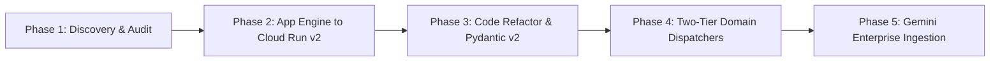

# Enterprise Agent Migration & Gemini Enterprise Integration

This repository contains the comprehensive enterprise operating manual, automation scripts, reference architectures, and runbooks for migrating **100+ legacy ADK agents** (across 10+ workflow applications) to modern agent frameworks and surfacing them into **Gemini Enterprise**.

---

## 📑 Core Documentation

- **[Operating Manual & Migration Runbook](./ENTERPRISE_OPERATING_MANUAL_AND_MIGRATION_RUNBOOK.md)**: The complete specification, covering:
  - **Module 1**: Inventory, Discovery & Dependency Audit
  - **Module 2**: Codebase & Dependency Upgrade Blueprint (Python 3.11+, Pydantic v2, OpenAPI 3.1)
  - **Module 3**: Runtime Hosting Convergence (Retiring App Engine $\rightarrow$ Cloud Run v2, GKE Enterprise, Agent Engine)
  - **Module 4**: Surfacing into Gemini Enterprise (Hierarchical Domain Supervisor Architecture & Vertex AI Extensions)
  - **Module 5**: Security, IAM (Zero-Trust Service Account token exchange) & VPC Service Controls
  - **Module 6**: 12-Week Phased Cutover Runbook & Traffic Shadowing Strategy
  - **Module 7**: Observability, Distributed Tracing, Alerting Matrix & SRE Diagnostic Runbook

---

## 🛠️ Included Utilities & Starter Scripts

- `scripts/scan_legacy_adk_agents.py`: Automated discovery tool to scan repositories for legacy ADK dependencies and imports.
- `scripts/register_vertex_extension.py`: Automated script for registering OpenAPI agent endpoints into Vertex AI Extensions.
- `templates/modern_agent_service.py`: Standardized FastAPI + Pydantic v2 template for Cloud Run v2 agent deployments.

---

## 🚀 Quick Reference: 5-Stage Migration Flow

---

## 🔐 Security & Governance Standard
- **Identity**: Token exchange via Google Service Account OIDC (`roles/run.invoker`, `roles/aiplatform.user`).
- **Network**: Private Service Connect (PSC) and Serverless VPC Access.
- **Auditing**: Full trace propagation across Gemini Enterprise, Vertex AI, and backend agent runtimes via W3C `traceparent`.
